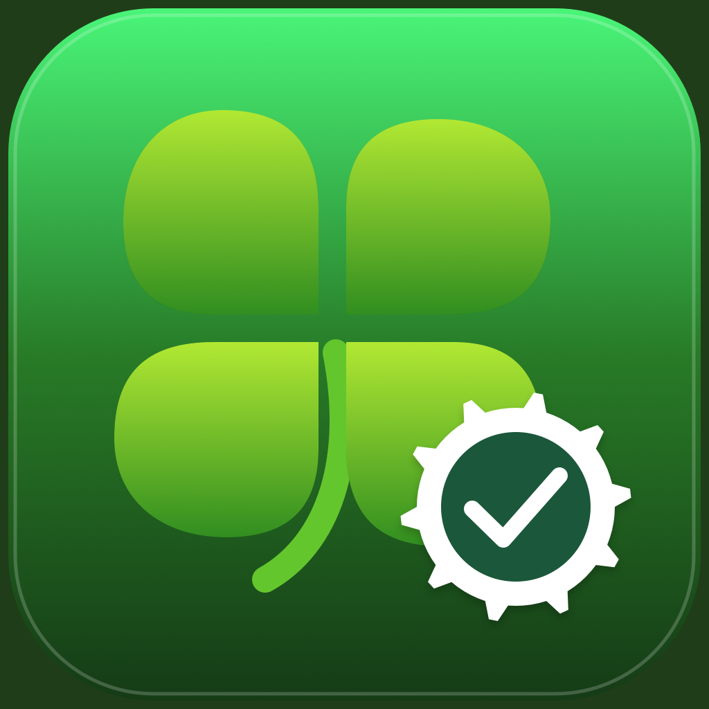

# Clover Config Checker

Credits: [chris1111](https://github.com/chris1111/CloverConfigChecker)

Aplicativo macOS em SwiftUI para verificar configurações do Clover EFI. Arraste um arquivo `.plist` para a janela e consulte os erros, avisos e seções verificadas.



O aplicativo **apenas lê o arquivo**: não modifica a configuração, não monta a EFI e não instala nada no sistema.

## Baixar e abrir o aplicativo

1. Baixe [Clover-Config-Checker-macOS.zip](dist/Clover-Config-Checker-macOS.zip) usando o botão **Download raw file** do GitHub.
2. Extraia o ZIP no Finder.
3. Arraste **Clover Config Checker.app** para **Aplicativos**, se desejar.
4. Abra o aplicativo com dois cliques.

### Requisitos

- macOS **13 Ventura ou superior**.
- **Python 3.8 ou superior** instalado no Mac. O checker está incluído no app, mas o interpretador Python não.
- O ZIP atual foi compilado para **Mac Intel (x86_64)**. Em Apple Silicon, requer Rosetta; para uma versão nativa, compile o projeto no próprio Mac.

Se faltar Python, instale uma versão atual pelo [site oficial do Python](https://www.python.org/downloads/macos/). Você pode verificar sua instalação no Terminal:

```bash
python3 --version
```

O aplicativo procura Python no `PATH` e também em `/opt/homebrew/bin`, `/usr/local/bin` e `/usr/bin`.

**Assinatura:** este build usa assinatura local (ad-hoc), não assinatura Developer ID nem notarização da Apple. Por isso, um download pode ser bloqueado pelo Gatekeeper. Se você confia na origem, tente abrir e consulte **Ajustes do Sistema → Privacidade e Segurança → Abrir Mesmo Assim**, quando essa opção estiver disponível. Não é necessário desativar as proteções do macOS.

## Como usar

1. Abra **Clover Config Checker**.
2. Arraste **um arquivo `.plist` por vez** para a área indicada, ou clique em **Escolher arquivo…**.
3. Aguarde a verificação.
4. Leia o relatório. Use a rolagem vertical para ver todo o conteúdo.
5. Clique em **Copiar relatório** para compartilhar o resultado em texto simples.

Você pode verificar uma cópia da configuração ou selecionar um arquivo em uma EFI já montada. Um caminho comum é `/Volumes/EFI/EFI/CLOVER/config.plist`, mas o nome do volume pode variar.

### Cores e resultados

| Cor / resultado | Significado |
|---|---|
| Verde | Seção verificada sem problemas ou resultado `VALID` |
| Vermelho / `ERROR` | Erro encontrado pelas regras do checker |
| Amarelo ou âmbar / `WARNING` | Opção suspeita, obsoleta ou fora do intervalo previsto |
| Azul-claro / `NOTE` | Informação adicional |
| `INVALID` | Foi encontrado pelo menos um erro |
| Não foi possível verificar | Falha ao ler o arquivo, interpretar o plist ou executar o checker |

A interface usa fundo e letras verdes que acompanham automaticamente os modos **claro e escuro do macOS**.

**Importante:** `VALID` não garante que seu computador vá iniciar nem que a configuração seja adequada ao hardware. `INVALID` significa que o arquivo não passou nas regras implementadas; essas regras também podem ter limitações. Confira a versão do Clover e a documentação antes de alterar sua configuração.

Chaves terminadas em `?` são tratadas como documentação inativa: o Clover as ignora. O checker explica isso no relatório.

## Abrir e compilar no Xcode

1. Baixe o repositório completo ou faça o clone:

   ```bash
   git clone https://github.com/maxpicelli/clover-config-checker.git
   cd clover-config-checker
   ```

   Como o repositório é privado, o GitHub exige uma conta com acesso.

2. Abra o projeto:

   ```bash
   open "macOS/Clover Config Checker.xcodeproj"
   ```

3. Selecione o esquema **Clover Config Checker** e o destino **My Mac**.
4. Pressione **⌘R** para compilar e executar.
5. Para executar os testes, pressione **⌘U**.

Use uma versão do Xcode compatível com Swift 5.9 ou superior. A compilação local não exige selecionar uma equipe de desenvolvimento.

**Mantenha a estrutura de pastas:** o projeto usa os arquivos Python da pasta `clover_config_checker` na raiz do repositório. A etapa **Include Python checker** os copia automaticamente para dentro do app em cada compilação.

Para localizar o aplicativo compilado no Xcode, expanda **Products**, clique com o botão direito em **Clover Config Checker.app** e escolha **Show in Finder**.

Para distribuir com Developer ID e notarização, configure sua própria assinatura e conta Apple Developer.

## Compilar pelo Terminal

Na raiz do projeto, com as ferramentas do Xcode instaladas:

```bash
bash build_app.sh
open "dist/Clover Config Checker.app"
```

O script gera o aplicativo e o ZIP em `dist/`, usando a arquitetura do Mac que fez a compilação.

Ao alterar o checker Python, compile novamente para atualizar a cópia incluída no aplicativo.

## Usar sem a interface gráfica

O checker também funciona no Terminal com Python 3.8+, sem dependências externas:

```bash
python3 -m clover_config_checker "/caminho/para/config.plist"
```

Exemplos incluídos:

```bash
python3 -m clover_config_checker samples/config-valid.plist
python3 -m clover_config_checker samples/config-bad-typo.plist
```

O primeiro deve retornar `VALID`; o segundo deve apontar erros.

Também existe um script de integração:

```bash
./run_config_check.sh ~/Desktop/config.plist
```

Execute a partir da raiz do projeto ou informe o caminho completo do script. `./` significa **pasta atual**, não uma subpasta.

### Opções da CLI

```text
--brief        Oculta a lista de seções verificadas
--quiet, -q    Mostra apenas o resultado por arquivo
--oneline      Relatório compacto
--strict, -s   Faz avisos também causarem falha
--color never Desativa cores de terminal
--version      Mostra a versão do checker
```

Você pode passar vários arquivos para a CLI. Os códigos de saída são:

- `0`: válido, podendo conter avisos.
- `1`: inválido, ou avisos com `--strict`.
- `2`: falha de leitura, interpretação ou uso.

**O script `run_config_check.sh` é voltado à integração de builds:** normalmente continua com código `0` mesmo quando encontra problemas. Para propagar falhas de validação, use:

```bash
CHECKER_STRICT=1 ./run_config_check.sh ~/Desktop/config.plist
```

Para automação com tratamento explícito de arquivos inexistentes, prefira a CLI Python diretamente.

## Testes

```bash
python3 test_cli.py
swift test --package-path macOS
```

Os testes Swift cobrem integração com o checker, arquivos válidos e inválidos, arquivo inexistente, caminhos com espaços e acentos, preservação do arquivo e formatação colorida.

## Estrutura

- `macOS/Clover Config Checker.xcodeproj`: projeto nativo do Xcode.
- `macOS/Sources/CloverConfigCheckerApp`: interface SwiftUI e integração.
- `macOS/Tests`: testes Swift.
- `macOS/Resources`: ícone PNG, ICNS e tamanhos para macOS.
- `clover_config_checker`: implementação Python e esquema de validação.
- `samples`: configurações de exemplo para testes, não recomendações para seu hardware.
- `dist/Clover-Config-Checker-macOS.zip`: aplicativo compilado.

O ícone foi desenhado por código e pode ser regenerado:

```bash
swift macOS/Tools/GenerateIcon.swift macOS/Resources
```

Não envie sua configuração pessoal para o repositório. Ela pode conter números de série e outros identificadores. Caches, builds intermediários, preferências pessoais do Xcode e o arquivo `config.plist` da raiz estão ignorados pelo Git.

## Licença e créditos

Distribuído sob a [licença MIT](LICENSE), preservando os avisos de autoria originais. Ferramenta complementar ao [Clover Bootloader](https://github.com/CloverHackyColor/CloverBootloader).

Thanks to: https://github.com/chris1111 @chris1111 
